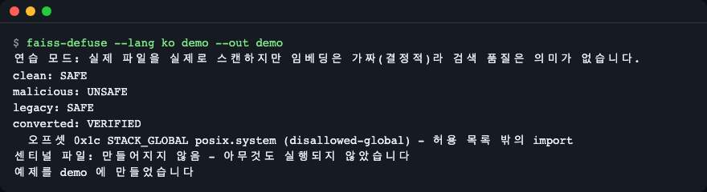
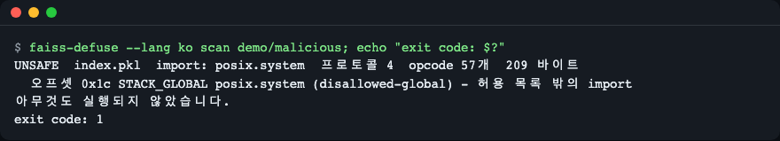
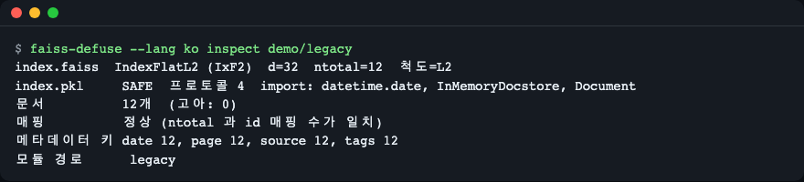
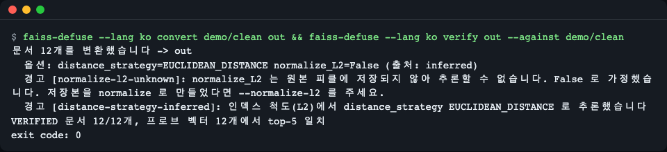
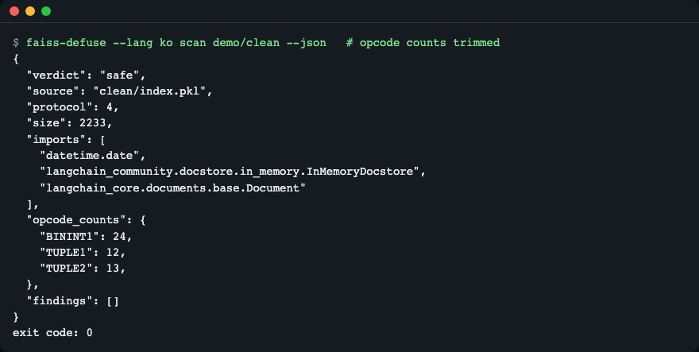
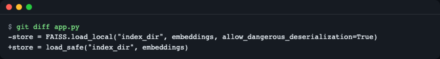

# faiss-defuse

[English](README.md) | **한국어**

LangChain FAISS 저장본(`index.faiss` + `index.pkl`)을 **피클을 실행하지 않고**, `allow_dangerous_deserialization=True` 없이 검사·변환·불러오게 해 주는 파이썬 라이브러리와 작은 CLI 입니다. 핵심 기능은 표준 라이브러리만 씁니다.



*내장 데모는 정상 저장본, 함정이 든 저장본, 옛 형식 저장본을 스캔하고 하나를 변환한 뒤, 아무것도 실행되지 않았음을 보여 줍니다.*

## 무엇을 하나

`FAISS.save_local()` 은 파일 두 개를 씁니다. `index.faiss`(벡터)와 `index.pkl`(문서, 파이썬 피클)입니다. `FAISS.load_local()` 은 `allow_dangerous_deserialization=True` 를 주지 않으면 피클을 읽지 않고, 흔한 조언은 "직접 만든 파일만 불러라"입니다. 저장본을 내려받거나 팀끼리 주고받거나 이미지에 넣어 배포하는 상황에서는 지키기 어렵습니다.

faiss-defuse 는 대신 다섯 가지를 합니다.

| 단계 | 하는 일 | FAISS 필요? |
|---|---|---|
| `scan` | 피클의 명령어 목록을 실행하지 않고 읽어 `safe` / `unsafe` 로 판정하고, 문제마다 바이트 위치를 알려 줍니다 | 아니오 |
| `inspect` | `index.faiss` 헤더(인덱스 종류·차원·벡터 수·척도), 문서 수, 메타데이터 키를 보여 줍니다 | 아니오 |
| `convert` / `save_safe` | 피클 없는 사본을 만듭니다: `index.faiss` + `docstore.jsonl` + `manifest.json`(두 파일의 SHA-256) | `save_safe` 만 |
| `load_safe` | 플래그 없이 평범한 LangChain `FAISS` 객체를 돌려줍니다 | 예 |
| `verify` | 해시를 확인하고, 변환본과 원본의 내용·top-k 검색 결과를 비교합니다 | top-k 부분만 |

엑스레이 기계와 봉인 상자를 떠올리면 됩니다. 엑스레이(`scan`)는 소포를 열지 않고 속을 들여다봅니다. 봉인 상자(피클 없는 형식)는 그 뒤에 배포하는 물건이고, 뜯은 흔적을 알려 주는 스티커가 해시입니다.

## 플래그가 위험한 이유

피클은 데이터가 아닙니다. 작은 스택 기계에 주는 **명령어 목록**이고, 명령어 하나(`REDUCE`)는 가져온(import) 함수를 아무거나 호출할 수 있습니다. 아래는 데모의 함정 `index.pkl` 맨 앞 명령어입니다(`pickletools.dis` 출력, 일부만).

```text
    0: \x80 PROTO      4
    2: \x95 FRAME      221
   11: \x8c SHORT_BINUNICODE 'posix'
   18: \x94 MEMOIZE    (as 0)
   19: \x8c SHORT_BINUNICODE 'system'
   27: \x94 MEMOIZE    (as 1)
   28: \x93 STACK_GLOBAL
   29: \x94 MEMOIZE    (as 2)
```

오프셋 28 의 `STACK_GLOBAL` 이 `posix.system`(리눅스·macOS 의 `os.system`)을 가져오고, 뒤따르는 `REDUCE` 가 호출합니다. `load_local(..., allow_dangerous_deserialization=True)` 는 파일을 읽는 순간 이 호출을 실행합니다. 데모의 페이로드는 무해합니다(표시용 파일을 만드는 `echo`). 데모는 그 파일이 만들어지지 않았음을 보여 줍니다.

## 설치

```bash
uv add "faiss-defuse[langchain] @ git+https://github.com/LeeGyeongPil/faiss-defuse"
# 또는 clone 해서:
git clone https://github.com/LeeGyeongPil/faiss-defuse && cd faiss-defuse && uv sync
```

Python 3.11 이상. `scan`·`inspect`·`convert` 는 런타임 의존성이 없습니다. `[langchain]` 추가 항목은 `load_safe`·`save_safe`·top-k 검사를 위해 `langchain-community`, `langchain-core`, `faiss-cpu`, `numpy` 를 설치합니다. uv 가 없다면 `curl -LsSf https://astral.sh/uv/install.sh | sh` 로 설치하세요(최소 리눅스 이미지는 `git`, `curl` 도 필요).

## 빠르게 시작하기 (1분 안팎)

clone 후 `uv sync` 를 마친 상태에서:

```bash
uv run faiss-defuse demo --out /tmp/faiss-defuse-demo
```

```text
Practice mode: real scans on real files, but the embeddings are fake and deterministic (search quality is meaningless).
clean: SAFE
malicious: UNSAFE
legacy: SAFE
converted: VERIFIED
  offset 0x1c STACK_GLOBAL posix.system (disallowed-global) - import outside the allow-list
sentinel file: not created - nothing was executed
samples written to /tmp/faiss-defuse-demo
```

(위는 영어 출력입니다. `--lang ko` 를 붙이면 한국어로 나옵니다. 화면 속 한국어 출력은 아래 스크린샷을 보세요.)

**연습용 데이터입니다.** 데모는 모델이나 API 키 없이 오프라인으로 돌도록 해시 기반의 가짜 임베딩으로 저장본을 만들므로 검색 품질은 의미가 없습니다. 스캔·변환·검증은 진짜 파일에 대해 진짜로 실행됩니다. 실제 저장본과 다른 점은 진짜 임베딩이 아니라는 것뿐입니다.

이제 내 저장본(`save_local` 이 만든 디렉터리)을 스캔합니다.

```bash
uv run faiss-defuse scan path/to/your_index_dir
```

데모의 함정 저장본에 돌리면 거부(종료 코드 1)를 볼 수 있습니다.



*`scan` 은 finding(`disallowed-global`), opcode, 오프셋, import 를 알려 줍니다. 아무것도 실행되지 않았습니다.*

## 단계별 따라 하기

1. 받은 저장본을 **scan** 합니다. 데모의 정상 저장본:

   ```bash
   uv run faiss-defuse scan /tmp/faiss-defuse-demo/clean
   ```
   ```text
   SAFE  index.pkl  imports: datetime.date, InMemoryDocstore, Document  protocol 4  783 opcodes  2,233 bytes
   Nothing was executed.
   ```
   `safe` 는 피클이 LangChain FAISS 저장본이 쓰는 이름만 가져온다는 뜻입니다([한계](#검사가-동작하는-방식) 참고). "알려진 나쁜 이름"만이 아니라 허용 목록 밖은 전부 거부합니다.

2. **inspect** 합니다. FAISS 가 없어도 되고, 예전 `langchain.*` 모듈 경로를 쓰는 옛 저장본도 읽습니다.

   ```bash
   uv run faiss-defuse inspect /tmp/faiss-defuse-demo/legacy
   ```
   ```text
   index.faiss  IndexFlatL2 (IxF2)  d=32  ntotal=12  metric=L2
   index.pkl     SAFE  protocol 4  imports: datetime.date, InMemoryDocstore, Document
   documents     12  (orphans: 0)
   mapping       OK (ntotal matches the id map)
   metadata keys date 12, page 12, source 12, tags 12
   module paths  legacy
   ```

   

   *헤더 정보는 FAISS 가 파일을 만지기 전에 표준 라이브러리로 `index.faiss` 앞부분 바이트를 읽어 얻습니다.*

3. **convert** 하고 **verify** 합니다.

   ```bash
   uv run faiss-defuse convert /tmp/faiss-defuse-demo/clean /tmp/faiss-defuse-demo/c2 --overwrite
   uv run faiss-defuse verify /tmp/faiss-defuse-demo/c2 --against /tmp/faiss-defuse-demo/clean
   ```
   ```text
   Converted 12 documents -> /tmp/faiss-defuse-demo/c2
     options: distance_strategy=EUCLIDEAN_DISTANCE normalize_L2=False (source: inferred)
     warning [normalize-l2-unknown]: normalize_L2 is not stored in the original pickle and cannot be inferred; assumed False. Pass normalize_l2=True (CLI: --normalize-l2) if the store was built with it.
     warning [distance-strategy-inferred]: distance_strategy EUCLIDEAN_DISTANCE inferred from the index metric (L2)
   VERIFIED 12/12 docs, top-5 equal for 12 probe vectors
   ```

   

   *LangChain 은 `normalize_L2` 와 거리 전략을 피클에 저장하지 않습니다. 저장본을 `normalize_L2=True` 로 만들었다면 `--normalize-l2` 로 알려 주세요. 그렇지 않으면 점수가 조용히 달라질 수 있어서 경고가 나옵니다.*

4. 플래그 없이 **불러옵니다**([라이브러리](#라이브러리) 참고).

## CLI

| 명령 | 용도 | 유용한 옵션 |
|---|---|---|
| `faiss-defuse scan PATH` | 실행 없이 판정 | `--json`, `--index-name`, `--limit` |
| `faiss-defuse inspect PATH` | 헤더·문서 수·매핑 검사·메타데이터 키 | `--json`, `--limit` |
| `faiss-defuse convert SRC DST` | 피클 없는 사본 | `--normalize-l2`, `--distance-strategy`, `--overwrite`, `--json`, `--limit` |
| `faiss-defuse verify DIR` | 해시 확인. `--against` 를 주면 내용·top-k 까지 | `--against ORIGINAL`, `--k`, `--probes`, `--trust-original`, `--json`, `--limit` |
| `faiss-defuse demo` | 오프라인 샘플 저장본과 전체 흐름 (`[langchain]` extra 필요) | `--out DIR` |

종료 코드: `0` 정상, `1` 검사 실패(unsafe·미지원 내용·불일치), `2` 사용법 오류, `3` 손상되었거나 읽을 수 없거나 한도를 넘은 입력, `4` 선택 의존성 없음.

`--json` 은 CI 용 기계 판독 출력입니다. 키와 finding `code` 값은 언어와 무관하고 `message` 만 번역됩니다. 정상 저장본:



*(스크린샷에서는 `opcode_counts` 를 줄였습니다.)*

`verify --trust-original` 은 원본을 LangChain 의 `load_local` 로도 불러 비교합니다. 그러면 **원본 피클이 실행되므로** 직접 만든 저장본에만 쓰세요. 그냥 `verify` 는 실행하지 않습니다.

**화면 언어.** `--lang en|ko`, 또는 `FAISS_DEFUSE_LANG=en|ko`, 그다음 `LC_ALL` / `LC_MESSAGES` / `LANG` 순입니다. 한국어가 아니면 영어로 나옵니다.

## 라이브러리

```python
from faiss_defuse import load_safe, save_safe, scan
```

애플리케이션에서 한 줄만 바꿉니다.



*같은 호출에서 플래그만 뺍니다. `load_safe` 는 원본 `save_local` 디렉터리(피클을 실행하지 않고 스캔·디코드)와 피클 없는 저장본(해시를 먼저 확인)을 모두 받습니다.*

실행 가능한 예제 [`examples/quickstart.py`](examples/quickstart.py)(가짜 임베딩 클래스를 써서 오프라인으로 돌아갑니다):

```bash
uv run python examples/quickstart.py
```

```text
scan: safe ['langchain_community.docstore.in_memory.InMemoryDocstore', 'langchain_core.documents.base.Document']
files: ['docstore.jsonl', 'index.faiss', 'manifest.json']
top hit: dogs bark {'n': 2}
```

(`langchain-community` 는 더 이상 유지보수되지 않아 import 때 `DeprecationWarning` 을 냅니다. 위 출력은 `python -W ignore::DeprecationWarning` 으로 얻었습니다.)

### API

| 이름 | 하는 일 | 주요 인자 | 반환 / 예외 |
|---|---|---|---|
| `scan(path)` | 저장본 디렉터리나 `index.pkl` 의 정적 판정 | `limits`, `index_name` | `ScanReport`(`verdict`, `imports`, `findings`) |
| `scan_bytes(data)` | 메모리 속 바이트 판정 | `limits`, `source` | `ScanReport` |
| `read_faiss_header(path)` | `index.faiss` 헤더 검증·해석 | | `FaissHeader` |
| `inspect(path)` | 헤더·문서 수·매핑·메타데이터 요약 | `index_name`, `limits` | `StoreInfo` |
| `convert(src, dst)` | 원본 저장본을 피클 없는 저장본으로 | `distance_strategy`, `normalize_l2`, `overwrite`, `index_name` | `Manifest`; `UnsafePickleError`, `UnsupportedContentError`, `OutputExistsError` |
| `save_safe(vectorstore, dst)` | 살아 있는 LangChain `FAISS` 객체를 피클 없이 저장(실제 옵션 기록) | `overwrite` | `Manifest`; extra 필요 |
| `load_safe(path, embeddings)` | 플래그 없이 불러오기 | `distance_strategy`, `normalize_l2`, `allow_option_override`, `index_name` | LangChain `FAISS`; `ManifestMismatchError`, `MalformedStoreError`, `OptionConflictError`, `UnsafePickleError` |
| `verify(converted)` | 해시·헤더·매핑 검사. `original=` 이면 내용·top-k 까지 | `original`, `trust_original`, `k`, `probes` | `VerifyReport` |
| `Limits` | 악의적 입력용 크기·opcode·노드·깊이 한도([자원 한도](#자원-한도) 참고) | `max_doc_nodes=...` 등 필드 | 데이터클래스 |

모든 오류는 `DefuseError` 의 하위 클래스입니다(extra 가 없으면 `MissingExtraError`).

## CI 레시피

인덱스를 만든 뒤 빌드 단계에서:

```python
save_safe(store, "dist/index_store", overwrite=True)
```

산출물을 게시하기 전(원본과 비교해 불일치면 작업이 실패합니다):

```bash
faiss-defuse scan build/index_dir          # 피클이 safe 가 아니면 종료 코드 1
faiss-defuse verify dist/index_store --against build/index_dir
```

서비스에서는 `load_safe("dist/index_store", embeddings)` 를 씁니다. 해시가 맞지 않으면 파일이 FAISS 에 닿기 전에 `ManifestMismatchError` 가 납니다. 해시는 *전달 중* 변조를 막지만, 파일과 매니페스트를 함께 다시 쓰는 사람은 막지 못합니다. `verify --against` 가 원본과 비교해 그것을 잡습니다.

## 피클 없는 형식

파일 세 개: `index.faiss`(그대로), `docstore.jsonl`(한 줄에 문서 하나, JSON 에 없는 값은 `{"$tuple": [...]}`·`{"$date": "2025-01-01"}` 같은 타입 태그), `manifest.json`(형식 버전, 두 파일의 SHA-256·크기, 인덱스 정보, FAISS 옵션). 자세한 내용과 전체 태그 표는 [docs/format.md](docs/format.md)(영어)에 있습니다.

## 검사가 동작하는 방식

두 관문이 차례로 있습니다.

1. **정적 스캔.** `pickletools.genops` 가 opcode 를 읽습니다. 심볼릭 스택이 `MEMOIZE`/`BINGET` 을 거치는 문자열도 따라가므로, memo 참조 뒤에 숨은 `builtins.eval` 도 잡힙니다. 정확히 일치하는 `(module, name)` 허용 목록만 통과합니다. `STOP` 뒤 남는 데이터, 확장 코드, persistent id, 점 표기 이름은 거부합니다.
2. **무해한 디코더.** 통과한 뒤에야 디코더가 스텁 클래스로 명령어에서 `(id, page_content, metadata)` 를 복원합니다. LangChain 을 import 하지 않으므로 안전 판정이 LangChain 클래스가 노출하는 속성에 좌우되지 않습니다. 허용된 실제 클래스를 돌려주는 제한 Unpickler 는 그 클래스가 노출하는 속성을 통해 우회될 수 있어서 이 라이브러리는 쓰지 않습니다.

`index.faiss` 도 입력입니다. 헤더(알려진 `fourcc`, 그럴듯한 `d`·`ntotal`, flat 인덱스는 벡터 수에 맞는 파일 크기)를 `faiss.read_index` 를 부르기 **전에** `struct` 로 검사합니다. 지원 인덱스 종류: `IxF2 IxFI IxFl IHNf IwFl IxMp IxM2 IxPq`. `docstore.jsonl` 은 매니페스트와 벡터 수에 대조합니다.

### 자원 한도

작고 악의적인 피클도 많은 일을 시킬 수 있습니다. 피클 참조는 객체를 복사하지 않고 다시 쓰기 때문입니다. 모든 한도는 메모리를 할당하거나 바이트를 쓰기 **전에** 검사합니다. 기본값:

| 한도 | 기본값 | 제한하는 것 |
|---|---|---|
| `max_pickle_bytes` | 512 MiB | `index.pkl` 크기 |
| `max_opcodes` | 50,000,000 | 스캔이 읽는 opcode 수 |
| `max_string_bytes` | 64 MiB | 피클 안 문자열 하나 |
| `max_faiss_bytes` | 16 GiB | `index.faiss` 크기 |
| `max_vectors` | 200,000,000 | 인덱스 헤더의 `ntotal` |
| `max_docstore_bytes` | 2 GiB | `docstore.jsonl` — 읽을 때와 `convert` 가 쓸 때 모두 |
| `max_findings` | 200 | 보고서 하나에 나열하는 finding 수 |
| `max_depth` | 100 | 중첩 깊이 |
| `max_doc_nodes` | 100,000 | 문서 하나의 메타데이터 값 수(공유 참조는 매번 셈) |
| `max_total_nodes` | 10,000,000 | 저장본 전체의 값 수 |

한도를 넘으면 `limit-exceeded` 로 멈춥니다(`convert`·`inspect`·`verify` 는 종료 3, `scan` 은 그 finding 과 함께 `UNSAFE`). 바꿀 수 없는 한도가 하나 더 있습니다. 디코드하는 동안 `frozenset(...)` 같은 생성자가 복사하는 데이터는 피클 크기의 2배에 64 KiB 를 더한 값을 넘을 수 없습니다. 넘으면 `reference-amplification`(종료 3)으로 거부합니다. 정상 피클은 생성자 인자를 다시 쓰지 않고 그대로 적기 때문입니다. 자릿수가 4,300 을 넘는 정수는 `unsupported`(종료 1)로 보고합니다.

크지만 정상인 저장본이면 명령줄이나 파이썬에서 한도를 올립니다.

```bash
faiss-defuse convert SRC DST --limit max_doc_nodes=500000 --limit max_docstore_bytes=8000000000
```

```python
convert(src, dst, limits=Limits(max_doc_nodes=500_000))
```

`--limit NAME=NUMBER` 는 반복할 수 있고 `scan`·`inspect`·`convert`·`verify` 에서 씁니다. 값이 잘못되면 사용법 오류(종료 2)입니다. `convert` 가 실패하면 자신이 만든 대상 폴더를 지웁니다.

### 보장하지 않는 것

- FAISS 자체 파서는 격리되어 있지 않습니다. 헤더·크기 검사, 해시, `faiss-cpu>=1.16.0` 하한이 조작된 `index.faiss` 의 위험을 줄이지만 없애지는 못합니다. 격리 실행은 계획 중입니다.
- `safe` 판정은 피클에 대한 것이지 문서 본문 내용에 대한 판정이 아닙니다. `scan` 은 코드가 실행될 수 있는지만 판정하고 저장본을 디코드하지 않으므로, 메모리를 낭비하도록 만든 피클도 `SAFE` 로 나올 수 있습니다. 그런 저장본은 위 한도가 이후 `convert`·`inspect`·`verify`·`load_safe` 에서 막습니다. 기본 한도 안에서도 작은 피클이 `convert` 로 디스크에 최대 `max_docstore_bytes`(2 GiB)까지 쓰게 할 수 있습니다(메모리 사용은 작게 유지).
- 아직 지원하지 않음(unsafe 가 아니라 `unsupported` 로 보고, 종료 코드 1): `serialize_to_bytes()` 출력, Annoy·ScaNN 저장본, numpy 배열·pandas `Timestamp` 메타데이터.
- 스캔은 순수 파이썬입니다. 제작자 노트북에서 문서 100,000개(`index.pkl` 20.8 MB) 기준 약 2.7초, 변환 3.7초, 변환본 `load_safe` 0.7초.

## 언제 쓰나

- LangChain FAISS 저장본을 받거나 내려받거나 배포하면서 `allow_dangerous_deserialization` 을 켜는 일을 그만두고 싶을 때.
- 인덱스에 CI 관문과 해시로 검증되는 재현 가능한 산출물이 필요할 때.
- 다른 도구: LangChain 전용이 아닌 일반 피클 파일은 [fickling](https://github.com/trailofbits/fickling), [picklescan](https://github.com/mmaitre314/picklescan), 모델 가중치는 [safetensors](https://github.com/huggingface/safetensors). faiss-defuse 는 LangChain FAISS 구조만 알고 그 밖은 거부합니다.

## 문제 해결

| 증상 | 원인 | 해결 |
|---|---|---|
| `error: optional dependencies missing: ...` (종료 4) | `load_safe`·`save_safe`·top-k 는 extra 가 필요 | `faiss-defuse[langchain]` 설치 |
| 내 저장본이 `UNSAFE ... disallowed-global` | 피클이 허용 목록 밖의 것(예: 직접 만든 메타데이터 클래스)을 가져옴 | 플래그를 켜지 말고, 메타데이터를 단순 값으로 바꿔 저장본을 다시 만들기 |
| `limit-exceeded` 또는 `reference-amplification`, 종료 3 | 파일이 한도보다 크거나, 디코드하면 크기가 여러 배로 불어나게 만들어짐 | 저장본의 출처를 확인. 직접 만든 큰 저장본이면 `--limit NAME=NUMBER` (`reference-amplification` 은 올릴 수 없음) |
| `unsupported-value-type`, 종료 1 | 메타데이터에 numpy 배열이나 pandas 값이 있음 | 평범한 파이썬 값으로 바꿔 다시 만들기 |
| `MISMATCH ... does not match manifest.json` | 쓴 뒤에 파일이 바뀜 | 원본에서 `faiss-defuse convert` 로 다시 만들기 |
| 바꾼 뒤 점수가 달라짐 | `normalize_L2` 가 기록되지 않음 | `convert --normalize-l2` 또는 `load_safe(..., normalize_l2=True)` |

## 버전·호환성

유의적 버전(SemVer)을 따릅니다. 0.x 동안은 마이너 버전에서 API 가 바뀔 수 있고, [CHANGELOG.md](CHANGELOG.md)에 적습니다. Python 3.11·3.12·3.13, `langchain-community` 0.4.2, `langchain-core` 1.8.4, `faiss-cpu` 1.16.0, `numpy` 2.5.5 에서 확인했습니다. LangChain 이 `langchain-community` 를 보관(archive) 처리했으므로 스텁 디코더는 그것에 의존하지 않고, `[langchain]` extra 는 0.5 미만으로 제한합니다.

## 개발

```bash
uv sync
uv run pytest -q
```

## 출처 (2026-11-22 확인)

- LangChain `FAISS.load_local`: https://reference.langchain.com/python/langchain-community/vectorstores/faiss/FAISS/load_local
- `langchain-community` 종료 안내: https://github.com/langchain-ai/langchain-community/issues/674
- Python `pickletools`: https://docs.python.org/3/library/pickletools.html
- 피클 위험에 관한 Hugging Face 문서: https://huggingface.co/docs/hub/security-pickle
- CVE-2024-5998(FAISS 불러오기의 역직렬화 취약점): https://nvd.nist.gov/vuln/detail/CVE-2024-5998

## 라이선스

MIT.
