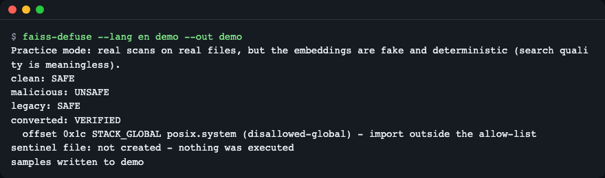
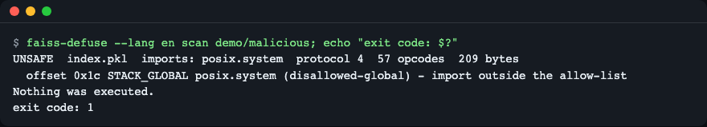
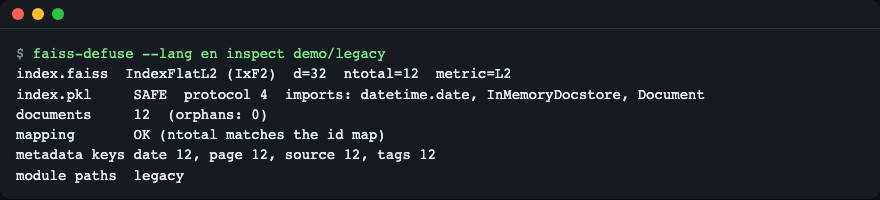
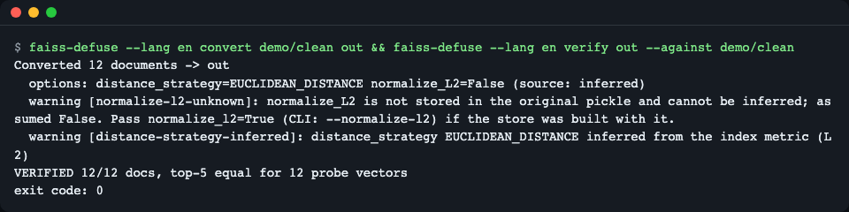
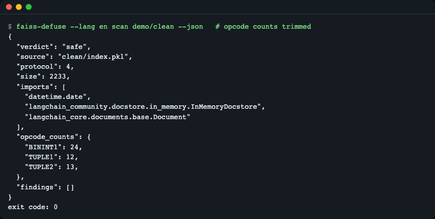
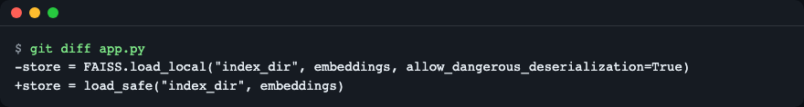

# faiss-defuse

**English** | [한국어](README.ko.md)

Check, convert and load LangChain FAISS stores (`index.faiss` + `index.pkl`) **without running the pickle** and without `allow_dangerous_deserialization=True`. A Python library and a small CLI. The core uses only the standard library.



*The built-in demo scans a clean store, a booby-trapped store and an old-format store, converts one, and proves nothing was executed.*

## What it does

`FAISS.save_local()` writes two files: `index.faiss` (the vectors) and `index.pkl` (your documents, as a Python pickle). `FAISS.load_local()` refuses to read the pickle unless you pass `allow_dangerous_deserialization=True`, and the usual advice is "only load files you made yourself". That is hard to follow when stores are downloaded, shared between teams or shipped in an image.

faiss-defuse gives you five things instead:

| Step | What it does | Needs FAISS? |
|---|---|---|
| `scan` | Reads the pickle's instructions without running them and says `safe` or `unsafe`, with the byte offset of each problem | no |
| `inspect` | Prints the `index.faiss` header (index type, dimension, vector count, metric), the document count and the metadata keys | no |
| `convert` / `save_safe` | Writes a pickle-free copy: `index.faiss` + `docstore.jsonl` + `manifest.json` (SHA-256 of both files) | `save_safe` only |
| `load_safe` | Returns a normal LangChain `FAISS` object, no flag needed | yes |
| `verify` | Checks hashes, then compares converted and original content and top-k search results | top-k part only |

Think of it as an X-ray machine plus a sealed box. The X-ray (`scan`) looks inside the parcel without opening it. The sealed box (the pickle-free format) is what you ship afterwards, with a tamper-evident sticker (the hashes).

## Why the flag is dangerous

A pickle is not data. It is a list of instructions for a small stack machine, and one instruction (`REDUCE`) can call any function it has imported. Here are the first instructions of the demo's booby-trapped `index.pkl` (from `pickletools.dis`, truncated; offsets depend on the payload):

```text
    0: \x80 PROTO      4
    2: \x95 FRAME      221
   11: \x8c SHORT_BINUNICODE 'posix'
   18: \x94 MEMOIZE    (as 0)
   19: \x8c SHORT_BINUNICODE 'system'
   27: \x94 MEMOIZE    (as 1)
   28: \x93 STACK_GLOBAL
   29: \x94 MEMOIZE    (as 2)
```

`STACK_GLOBAL` at offset 28 imports `posix.system` (the `os.system` of Linux and macOS). A later `REDUCE` calls it. `load_local(..., allow_dangerous_deserialization=True)` would run that call as the file loads. The demo's payload is harmless (`echo` creating a marker file), and the demo shows the marker is never created.

## Install

```bash
uv add "faiss-defuse[langchain] @ git+https://github.com/LeeGyeongPil/faiss-defuse"
# or, from a clone:
git clone https://github.com/LeeGyeongPil/faiss-defuse && cd faiss-defuse && uv sync
```

Python 3.11 or newer. No runtime dependencies for `scan`, `inspect` and `convert`. The `[langchain]` extra adds `langchain-community`, `langchain-core`, `faiss-cpu` and `numpy` for `load_safe`, `save_safe` and the top-k check. Install uv with `curl -LsSf https://astral.sh/uv/install.sh | sh` if you do not have it (a minimal Linux image also needs `git` and `curl`).

## Quick start (about a minute)

From a clone, with `uv sync` done:

```bash
uv run faiss-defuse demo --out /tmp/faiss-defuse-demo
```

```text
Practice mode: real scans on real files, but the embeddings are fake and deterministic (search quality is meaningless).
clean: SAFE
malicious: UNSAFE
legacy: SAFE
converted: VERIFIED
  offset 0x1c STACK_GLOBAL posix.system (disallowed-global) - import outside the allow-list
sentinel file: not created - nothing was executed
samples written to /tmp/faiss-defuse-demo
```

**Practice data.** The demo builds its stores offline with fake, hash-based embeddings, so no model or API key is needed and search quality is meaningless. The scans, the conversion and the verification are real, run on real files. Real stores differ only in having real embeddings.

Now scan your own store (a directory made by `save_local`):

```bash
uv run faiss-defuse scan path/to/your_index_dir
```

Run it on the demo's booby-trapped store to see a rejection (exit code 1):



*`scan` names the finding (`disallowed-global`), the opcode, the offset and the import. Nothing was executed.*

## Step by step

1. **Scan** the store you were given. The demo's clean store:

   ```bash
   uv run faiss-defuse scan /tmp/faiss-defuse-demo/clean
   ```
   ```text
   SAFE  index.pkl  imports: datetime.date, InMemoryDocstore, Document  protocol 4  783 opcodes  2,233 bytes
   Nothing was executed.
   ```
   `safe` means the pickle imports only the names a LangChain FAISS store uses (see [limits](#how-the-checks-work)). Everything else is rejected, not just "known bad" names.

2. **Inspect** it. This works without FAISS installed and also reads old stores whose pickles use the former `langchain.*` module paths:

   ```bash
   uv run faiss-defuse inspect /tmp/faiss-defuse-demo/legacy
   ```
   ```text
   index.faiss  IndexFlatL2 (IxF2)  d=32  ntotal=12  metric=L2
   index.pkl     SAFE  protocol 4  imports: datetime.date, InMemoryDocstore, Document
   documents     12  (orphans: 0)
   mapping       OK (ntotal matches the id map)
   metadata keys date 12, page 12, source 12, tags 12
   module paths  legacy
   ```

   

   *Header facts come from reading the first bytes of `index.faiss` with the standard library, before FAISS touches the file.*

3. **Convert** and **verify**:

   ```bash
   uv run faiss-defuse convert /tmp/faiss-defuse-demo/clean /tmp/faiss-defuse-demo/c2 --overwrite
   uv run faiss-defuse verify /tmp/faiss-defuse-demo/c2 --against /tmp/faiss-defuse-demo/clean
   ```
   ```text
   Converted 12 documents -> /tmp/faiss-defuse-demo/c2
     options: distance_strategy=EUCLIDEAN_DISTANCE normalize_L2=False (source: inferred)
     warning [normalize-l2-unknown]: normalize_L2 is not stored in the original pickle and cannot be inferred; assumed False. Pass normalize_l2=True (CLI: --normalize-l2) if the store was built with it.
     warning [distance-strategy-inferred]: distance_strategy EUCLIDEAN_DISTANCE inferred from the index metric (L2)
   VERIFIED 12/12 docs, top-5 equal for 12 probe vectors
   ```

   

   *LangChain does not save `normalize_L2` or the distance strategy in the pickle. If your store was built with `normalize_L2=True`, say so with `--normalize-l2`, otherwise scores can change silently. That is why the warning appears.*

4. **Load** it without any flag (see [Library](#library)).

## CLI

| Command | Purpose | Useful options |
|---|---|---|
| `faiss-defuse scan PATH` | Verdict without executing | `--json`, `--index-name`, `--limit` |
| `faiss-defuse inspect PATH` | Header, document count, mapping check, metadata keys | `--json`, `--limit` |
| `faiss-defuse convert SRC DST` | Pickle-free copy | `--normalize-l2`, `--distance-strategy`, `--overwrite`, `--json`, `--limit` |
| `faiss-defuse verify DIR` | Hashes; with `--against` also content and top-k | `--against ORIGINAL`, `--k`, `--probes`, `--trust-original`, `--json`, `--limit` |
| `faiss-defuse demo` | Offline sample stores and the whole flow (needs the `[langchain]` extra) | `--out DIR` |

Exit codes: `0` ok, `1` check failed (unsafe, unsupported content, mismatch), `2` usage error, `3` damaged, unreadable or over-limit input, `4` optional dependencies missing.

`--json` prints machine-readable output for CI. Keys and finding `code` values do not depend on the language; only `message` is translated. The clean store:



*(`opcode_counts` is trimmed in the screenshot.)*

`verify --trust-original` additionally loads the original with LangChain's own `load_local`. That **executes the original pickle**, so use it only on stores you built yourself. Plain `verify` never does.

**Display language.** `--lang en|ko`, or `FAISS_DEFUSE_LANG=en|ko`, then `LC_ALL` / `LC_MESSAGES` / `LANG`. Anything that is not Korean falls back to English. Korean output is shown in [README.ko.md](README.ko.md).

## Library

```python
from faiss_defuse import load_safe, save_safe, scan
```

One-line change in an application:



*The same call, without the flag. `load_safe` accepts original `save_local` directories (scanned and decoded without running the pickle) and pickle-free stores (hashes checked first).*

A runnable example, [`examples/quickstart.py`](examples/quickstart.py) (it uses a fake embedding class, so it works offline):

```bash
uv run python examples/quickstart.py
```

```text
scan: safe ['langchain_community.docstore.in_memory.InMemoryDocstore', 'langchain_core.documents.base.Document']
files: ['docstore.jsonl', 'index.faiss', 'manifest.json']
top hit: dogs bark {'n': 2}
```

(`langchain-community` prints a `DeprecationWarning` on import because the package is no longer maintained; the output above was captured with `python -W ignore::DeprecationWarning`.)

### API

| Name | What it does | Main arguments | Returns / raises |
|---|---|---|---|
| `scan(path)` | Static verdict for a store directory or an `index.pkl` | `limits`, `index_name` | `ScanReport` (`verdict`, `imports`, `findings`) |
| `scan_bytes(data)` | Same for bytes in memory | `limits`, `source` | `ScanReport` |
| `read_faiss_header(path)` | Validates and parses the `index.faiss` header | | `FaissHeader` |
| `inspect(path)` | Header, document count, mapping and metadata summary | `index_name`, `limits` | `StoreInfo` |
| `convert(src, dst)` | Original store to pickle-free store | `distance_strategy`, `normalize_l2`, `overwrite`, `index_name` | `Manifest`; `UnsafePickleError`, `UnsupportedContentError`, `OutputExistsError` |
| `save_safe(vectorstore, dst)` | Save a live LangChain `FAISS` object pickle-free (records the real options) | `overwrite` | `Manifest`; needs the extra |
| `load_safe(path, embeddings)` | Load without the flag | `distance_strategy`, `normalize_l2`, `allow_option_override`, `index_name` | LangChain `FAISS`; `ManifestMismatchError`, `MalformedStoreError`, `OptionConflictError`, `UnsafePickleError` |
| `verify(converted)` | Hash, header, mapping checks; with `original=` also content and top-k | `original`, `trust_original`, `k`, `probes` | `VerifyReport` |
| `Limits` | Size, opcode, node and depth limits for hostile input (see [resource limits](#resource-limits)) | `max_doc_nodes=...` and the other fields | dataclass |

All errors derive from `DefuseError` (also `MissingExtraError` when the extra is not installed).

## CI recipe

Build step, after creating the index:

```python
save_safe(store, "dist/index_store", overwrite=True)
```

Before publishing the artifact (this step compares against the original and fails the job on mismatch):

```bash
faiss-defuse scan build/index_dir          # exit 1 if the pickle is not safe
faiss-defuse verify dist/index_store --against build/index_dir
```

In the serving app, `load_safe("dist/index_store", embeddings)`. A hash mismatch raises `ManifestMismatchError` before the file reaches FAISS. The hashes stop tampering *in transit*; they cannot stop someone who rewrites the files and the manifest together. `verify --against` catches that by comparing with the original.

## The pickle-free format

Three files: `index.faiss` (unchanged), `docstore.jsonl` (one document per line, with type tags such as `{"$tuple": [...]}` and `{"$date": "2025-01-01"}` for values JSON lacks), and `manifest.json` (format version, SHA-256 and size of both files, index facts, FAISS options). Details and the full tag table are in [docs/format.md](docs/format.md).

## How the checks work

Two gates, in order:

1. **Static scan.** `pickletools.genops` reads the opcodes. A symbolic stack follows strings through `MEMOIZE`/`BINGET`, so `builtins.eval` hidden behind a memo reference is still seen. Only an exact allow-list of `(module, name)` pairs passes. Trailing data after `STOP`, extension codes, persistent ids and dotted names are rejected.
2. **Inert decoder.** Only after a pass, a decoder rebuilds `(id, page_content, metadata)` from the instructions using stub classes. It never imports LangChain, so a safe verdict does not depend on what LangChain's classes expose. Restricted unpicklers that return real allowed classes can be bypassed through attributes those classes expose, so this library does not use one.

`index.faiss` is also input: the header (known `fourcc`, plausible `d` and `ntotal`, file size matching the vector count for flat indexes) is checked with `struct` **before** `faiss.read_index` is called. Supported index kinds: `IxF2 IxFI IxFl IHNf IwFl IxMp IxM2 IxPq`. `docstore.jsonl` is checked against the manifest and the vector count.

### Resource limits

A tiny hostile pickle can ask for a lot of work, because a pickle reference reuses an object instead of copying it. Every limit is checked **before** the memory is allocated or the bytes are written. Defaults:

| Limit | Default | What it bounds |
|---|---|---|
| `max_pickle_bytes` | 512 MiB | size of `index.pkl` |
| `max_opcodes` | 50,000,000 | opcodes the scan reads |
| `max_string_bytes` | 64 MiB | one string in the pickle |
| `max_faiss_bytes` | 16 GiB | size of `index.faiss` |
| `max_vectors` | 200,000,000 | `ntotal` in the index header |
| `max_docstore_bytes` | 2 GiB | `docstore.jsonl`, both when read and when written by `convert` |
| `max_findings` | 200 | findings listed in one report |
| `max_depth` | 100 | nesting depth |
| `max_doc_nodes` | 100,000 | values in one document's metadata, shared references counted each time |
| `max_total_nodes` | 10,000,000 | values in the whole store |

Going over a limit stops with `limit-exceeded` (exit 3 for `convert`, `inspect` and `verify`; `scan` reports `UNSAFE` with that finding). A second limit cannot be changed: while decoding, the data copied by constructors such as `frozenset(...)` may not exceed twice the pickle size plus 64 KiB. Beyond that the store is refused as `reference-amplification` (exit 3), because an honest pickle writes its constructor arguments out instead of reusing them. Integers with more than 4,300 digits are reported as `unsupported` (exit 1).

A big but honest store can raise a limit, from the command line or in Python:

```bash
faiss-defuse convert SRC DST --limit max_doc_nodes=500000 --limit max_docstore_bytes=8000000000
```

```python
convert(src, dst, limits=Limits(max_doc_nodes=500_000))
```

`--limit NAME=NUMBER` can be repeated and works on `scan`, `inspect`, `convert` and `verify`. A bad value is a usage error (exit 2). If `convert` fails, it removes the destination folder it created.

### What it does not guarantee

- FAISS's own parser is not sandboxed. Header and size checks, the hashes and a lower bound of `faiss-cpu>=1.16.0` reduce the risk from a crafted `index.faiss`; they do not remove it. An isolated read is planned.
- A `safe` verdict is about the pickle only, not about the text in your documents. `scan` decides whether code could run; it does not decode the store, so a pickle built to waste memory can still print `SAFE`. Such stores are stopped later, by the limits above, in `convert`, `inspect`, `verify` and `load_safe`. Within the default limits a small pickle can still make `convert` write up to `max_docstore_bytes` (2 GiB) to disk, with memory use kept small.
- Not supported yet (reported as `unsupported`, not as unsafe, exit 1): `serialize_to_bytes()` output, Annoy and ScaNN stores, numpy-array and pandas `Timestamp` metadata.
- The scan is pure Python: about 2.7 s for a 100,000-document store (20.8 MB `index.pkl`) on the author's laptop; convert 3.7 s, `load_safe` of a converted store 0.7 s.

## When to use it

- You receive, download or ship LangChain FAISS stores and want to stop enabling `allow_dangerous_deserialization`.
- You want a CI gate and a reproducible, hash-checked artifact for an index.
- Other tools: for generic pickle files (not LangChain-specific) see [fickling](https://github.com/trailofbits/fickling) and [picklescan](https://github.com/mmaitre314/picklescan); for model weights prefer [safetensors](https://github.com/huggingface/safetensors). faiss-defuse knows only the LangChain FAISS layout and rejects anything else.

## Troubleshooting

| Symptom | Cause | Fix |
|---|---|---|
| `error: optional dependencies missing: ...` (exit 4) | `load_safe`, `save_safe` or top-k need the extra | install `faiss-defuse[langchain]` |
| `UNSAFE ... disallowed-global` on your own store | the pickle imports something outside the allow-list (a custom metadata class, for example) | do not enable the flag; rebuild the store with plain-value metadata |
| `limit-exceeded` or `reference-amplification`, exit 3 | the file is larger than a limit, or built so that decoding would multiply its size | check where the store came from; if it is yours and large, pass `--limit NAME=NUMBER` (`reference-amplification` cannot be raised) |
| `unsupported-value-type`, exit 1 | metadata holds numpy arrays or pandas values | convert them to plain Python values and rebuild |
| `MISMATCH ... does not match manifest.json` | a file changed after it was written | rebuild with `faiss-defuse convert` from the original |
| scores differ after switching | `normalize_L2` was not recorded | `convert --normalize-l2` or `load_safe(..., normalize_l2=True)` |

## Versions and compatibility

Semantic Versioning. During 0.x, minor versions may change the API; see [CHANGELOG.md](CHANGELOG.md). Tested with Python 3.11, 3.12, 3.13, `langchain-community` 0.4.2, `langchain-core` 1.8.4, `faiss-cpu` 1.16.0, `numpy` 2.5.5. LangChain has archived `langchain-community`; this library keeps the stub decoder independent of it and the `[langchain]` extra is capped below 0.5.

## Development

```bash
uv sync
uv run pytest -q
```

## Sources (checked 2026-11-22)

- LangChain `FAISS.load_local`: https://reference.langchain.com/python/langchain-community/vectorstores/faiss/FAISS/load_local
- `langchain-community` sunset notice: https://github.com/langchain-ai/langchain-community/issues/674
- Python `pickletools`: https://docs.python.org/3/library/pickletools.html
- Hugging Face on pickle risks: https://huggingface.co/docs/hub/security-pickle
- CVE-2024-5998 (a deserialization vulnerability in FAISS loading): https://nvd.nist.gov/vuln/detail/CVE-2024-5998

## License

MIT.
